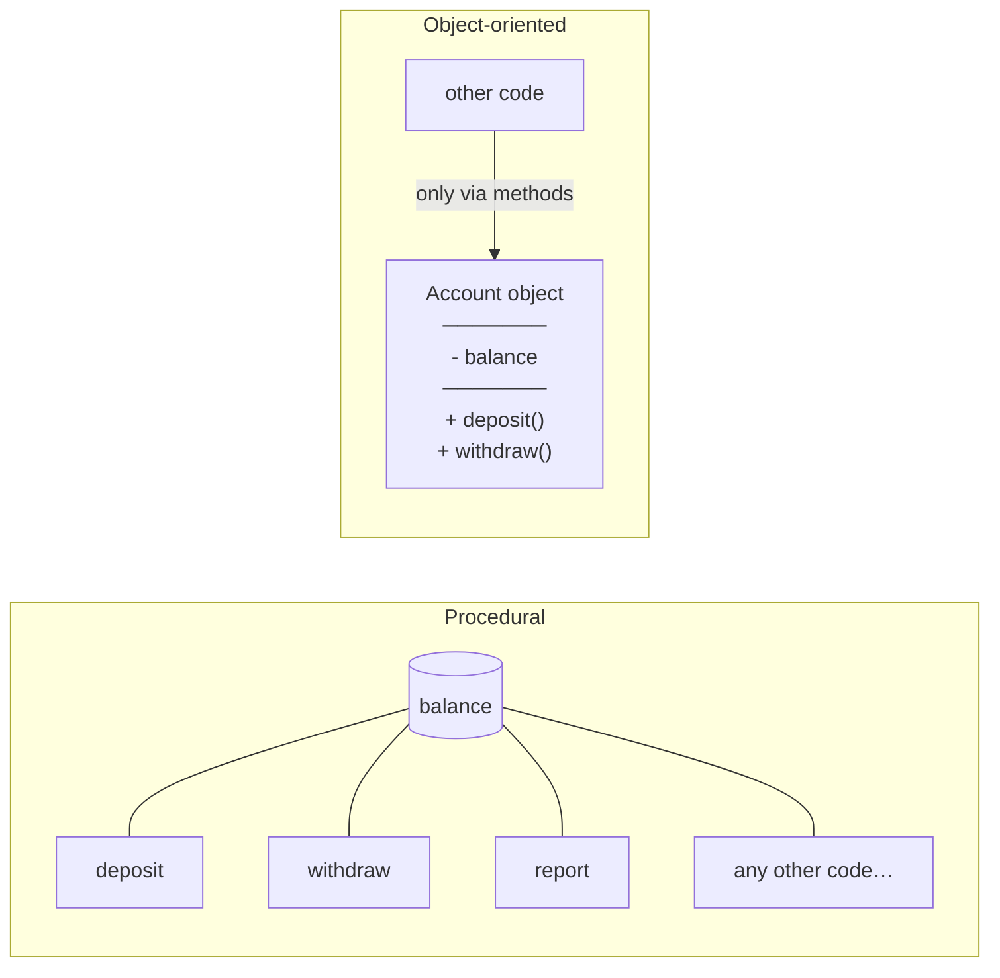
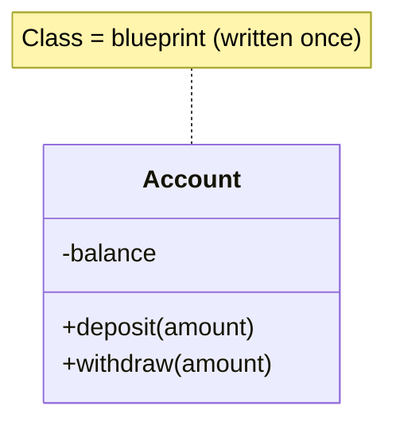

## The problem: data and rules drift apart

Imagine a bank account written with plain variables and functions:

```py
balance = 100
def withdraw(balance, amount):
    return balance - amount        # nothing stops a negative balance…

balance = withdraw(balance, 500)   # …or anyone writing  balance = -9999
```

As programs grow, hundreds of functions touch hundreds of variables. Any of them can break a rule, and when something
goes wrong you have to search everywhere.

## The OOP answer: put the rules next to the data



An **object** owns its data and offers **methods** to work with it. The `withdraw` method can refuse to overdraw,
and since outside code can only go through the methods, the rule can't be bypassed.

## The four pillars

| Pillar | One sentence | Chapter |
|---|---|---|
| **Encapsulation** | hide the data, expose safe operations | 04 |
| **Abstraction** | describe *what* something does, not *how* | 08 |
| **Inheritance** | build a specialised class from a general one | 06 |
| **Polymorphism** | one call, different behaviour depending on the object | 07 |

## Classes and objects in one picture



`Account` is the **class**: the blueprint. `alice_account` and `bob_account` are **objects** (instances): two
separate things built from it, each with its own balance.

> OOP isn't always the answer. Small scripts are often clearer as functions. It shines when you have *things with
> state and rules* - accounts, players, documents, UI widgets - and many parts of a program that use them.
