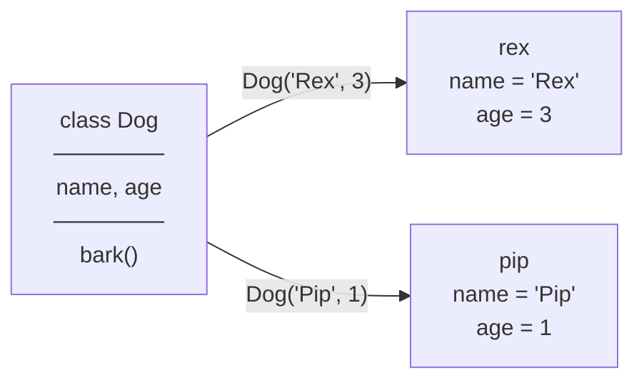

## Class vs object

A **class** describes a kind of thing: which data each one holds and what it can do. An **object** (or *instance*) is
one concrete thing made from that description, with its own data.

## Creating an object always has the same three phases

1. **Allocate** memory for the object.
2. **Initialise** it by running the constructor with the new object as `self`/`this`.
3. **Hand back** something that refers to it: a reference (Python, JS), or the object itself or a pointer (C++).

The languages differ in *where* the memory comes from and *what your variable holds*, and that's exactly what the
step-through above shows. Use the language switch at the top to compare all three.

## Variables vs objects

| You write | Python / JavaScript | C++ |
|---|---|---|
| `b = a` | `b` refers to **the same object** (two names, one object) | `Dog b = a;` makes a **copy**; `Dog& b = a;` makes an alias |
| change via `b` | `a` sees the change | copy: `a` unchanged · reference: `a` changes |

This single difference explains a large share of beginner bugs when moving between languages.
