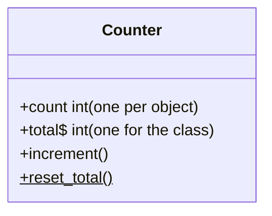

## Two kinds of members

- **Instance members** belong to each object: every counter has its own `count`.
- **Class (static) members** belong to the class: one `total` shared by all counters. In UML they're underlined, or marked `$` in Mermaid.

## How a method knows "which object?"

A method is written once but works on many objects. The trick is a hidden or explicit **first argument** that refers to
the object the method was called on:

| Language | You write | What really happens |
|---|---|---|
| Python | `a.increment()` | `Counter.increment(a)`, where `a` arrives as **self** |
| C++ | `a.increment()` | `Counter::increment(&a)`, where `&a` arrives as **this** |
| JavaScript | `a.increment()` | `increment` runs with **this = a**, because `a` is before the dot |

Step through the trace above in each language to watch `self`/`this` change between calls.

## Methods that read vs methods that change
Good method names make it obvious: `area()`, `is_empty()` and `balance` *read*; `deposit()`, `add()` and `reset()` *change*.
C++ even lets you **promise** a method won't change the object with `const`, and the compiler holds you to it.
