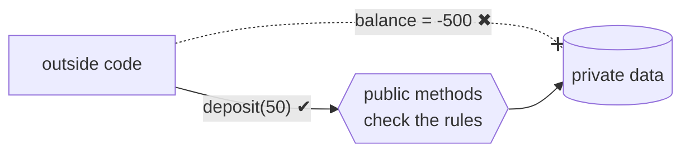

## Invariants: the rules an object promises to keep

A `BankAccount` promises its balance is never negative. A `Temperature` in Kelvin is never below zero. A `Date` never
holds 31 February. If any code can write to the fields, those promises mean nothing.

Encapsulation = **private data + public methods that guard it**.

## Levels of access

| | inside the class | subclasses | everyone else |
|---|---|---|---|
| **public** | ✅ | ✅ | ✅ |
| **protected** | ✅ | ✅ | ❌ |
| **private** | ✅ | ❌ | ❌ |

Each language implements this table differently. Click through the matrix above for the exact behaviour (and error
messages) in each one.

## Getters, setters and "tell, don't ask"
Don't automatically add a getter and setter for every field. That's public data with extra steps. Prefer methods that
**do something meaningful**: `account.withdraw(30)` instead of `account.set_balance(account.get_balance() - 30)`.
The object should make the decisions about its own data.
