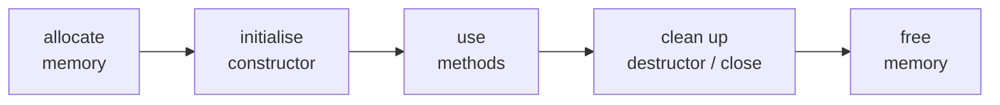

## Every object's life has three phases

The languages disagree mostly about the **last two phases**: *when* clean-up happens and *who* triggers it.

| | Python | C++ | JavaScript |
|---|---|---|---|
| strategy | reference counting (+ cycle collector) | **you** decide: scope, `delete`, smart pointers | tracing garbage collector |
| clean-up timing | immediately at count 0 (CPython) | exactly at end of scope | unpredictable |
| typical tool | `with` statement | RAII (destructors) | `try/finally`, `using` (newer) |

## RAII, the most important C++ idea
*Resource Acquisition Is Initialisation*: tie every resource (memory, file, lock, socket) to an object whose
**destructor** releases it. Since destructors run automatically at the end of scope, even when an exception is thrown,
resources can't leak. `std::unique_ptr`, `std::vector`, `std::fstream` and `std::lock_guard` all work this way.

## Copying objects
Assignment means different things:

- **Python / JavaScript**: `b = a` copies the *reference*. Both names see the same object. Use `copy.deepcopy` / `structuredClone` for independent copies.
- **C++**: `Dog b = a;` runs the **copy constructor** and makes an independent object. If your class owns raw resources you must define copying correctly (the **rule of three/five**), or better, let members like `std::vector` and `std::unique_ptr` handle it (the **rule of zero**).
