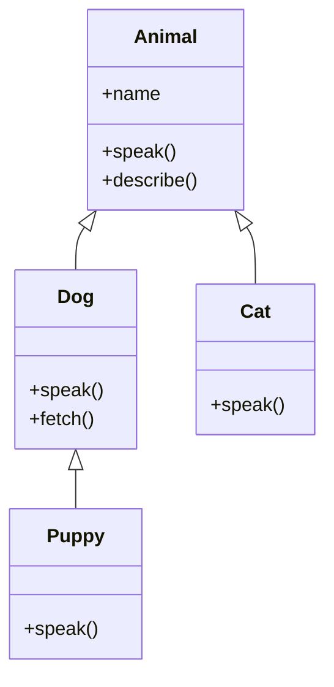

## Is-a: the test for inheritance

A subclass **inherits** everything from its parent, can **add** new members (`Dog.fetch`) and can **override**
inherited methods (`Dog.speak`). If "a Puppy *is a* Dog" and "a Dog *is an* Animal" read naturally, inheritance fits.

## Three things every subclass does
1. **Initialise the parent part first**: `super().__init__(…)`, `: Animal(name)`, `super(name)`.
2. **Override** where behaviour differs, keeping the same method signature.
3. **Extend**, not replace, when the parent's behaviour is still needed: call `super().method()` and add to it.

## Multiple inheritance and the diamond
When a class has two parents that share a grandparent, which version of a method wins? Python answers with a precise
algorithm (C3 linearisation), C++ makes you resolve ambiguities explicitly (and offers `virtual` inheritance), and
JavaScript avoids the question by allowing only one parent. Try it in the diamond explorer above.

> Liskov substitution principle: anywhere code expects an `Animal`, passing a `Dog` must still work correctly.
> If a subclass has to *disable* or *weaken* inherited behaviour, inheritance is the wrong tool.
