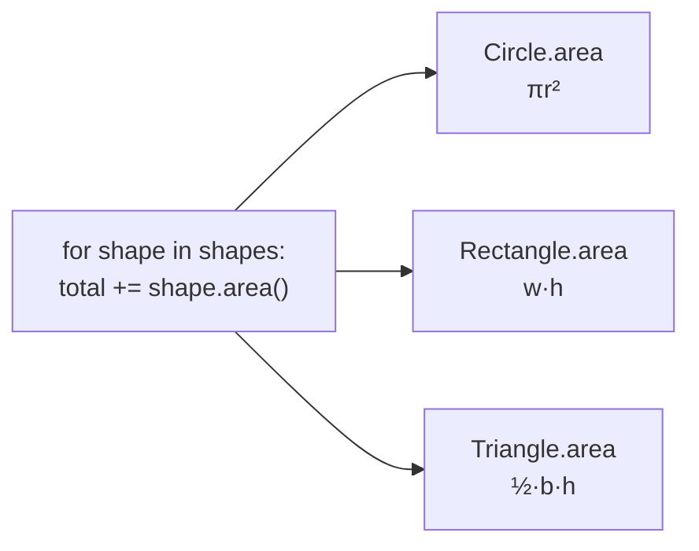

## The payoff

The loop doesn't know (or care) which shapes it has. Add a `Hexagon` class tomorrow and the loop still works. That's
**polymorphism**, Greek for "many forms", and it's what makes the **open/closed principle** possible: open for extension,
closed for modification.

## How does the call find its code?
Use the explorer above: pick an object and a method, and watch each language search.

- **Python** walks the class's **MRO** and takes the first class that defines the name.
- **JavaScript** walks the **prototype chain** until it finds the property or reaches `null`.
- **C++** binds non-virtual calls at **compile time** (from the variable's declared type). For `virtual` functions the
  object carries a hidden **vptr** to its class's **vtable**, a table of function pointers, and the call jumps through it.

## Other kinds of polymorphism
- **Duck typing** (Python, JS): no shared base class needed, just the right method.
- **Overloading** (C++): `print(int)` and `print(std::string)` are different functions, chosen at compile time.
- **Parametric / generic** (C++ templates, Python generics with type hints): one piece of code for many types.
