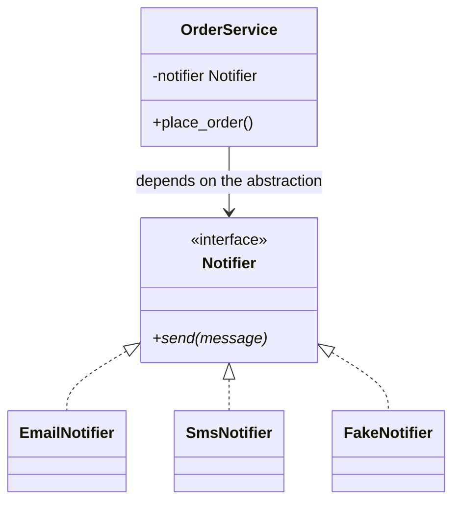

## Abstraction: the "what", not the "how"

A `Notifier` must be able to `send(message)`. **How** it sends (email, SMS, Slack, a fake for tests) is an
implementation detail.

`OrderService` depends only on `Notifier`. Pass it any implementation and it works. That's the **dependency
inversion principle**, and it's why abstractions make code testable.

## Abstract class vs interface
- An **abstract class** can mix implemented methods (shared behaviour) with abstract ones (holes subclasses must fill).
- An **interface** is all holes: just a contract.

Try the **Shape (abstract)** preset in the class builder below: the generated code shows `ABC` + `@abstractmethod`,
`= 0` pure virtual functions, and JavaScript's `new.target` check side by side.
