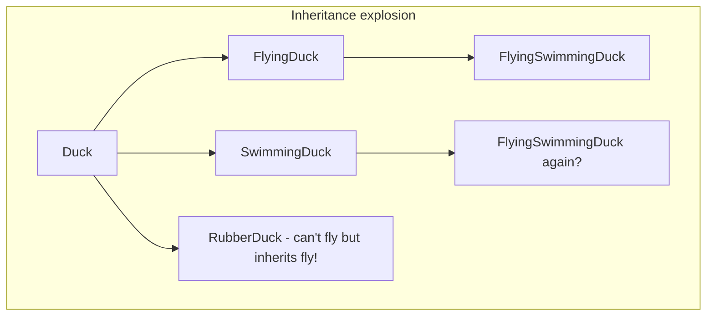
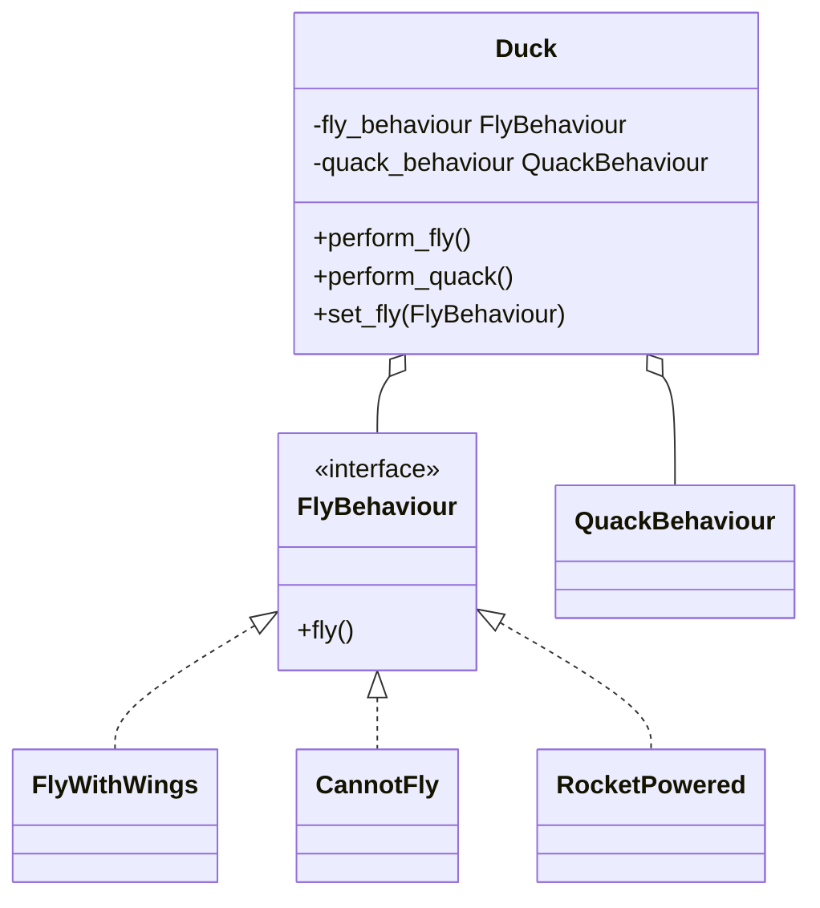

## The problem with inheritance-only designs

Each new combination of behaviours needs a new subclass, and some subclasses inherit things they must not have.

## The composition answer

A `Duck` **has** a fly behaviour and **delegates** to it. Combine behaviours freely, and change them at run time
(`duck.set_fly(RocketPowered())`). This is the **Strategy pattern**.

## Kinds of has-a
| Relationship | Meaning | Example |
|---|---|---|
| **Composition** | the part's life is tied to the whole | a `House` and its `Room`s |
| **Aggregation** | the part exists independently | a `Team` and its `Player`s |
| **Association** | objects merely know about each other | a `Student` and a `Course` |

> Rule of thumb: use inheritance for genuine **is-a** with shared behaviour; use composition for everything else.
> When in doubt, compose.
