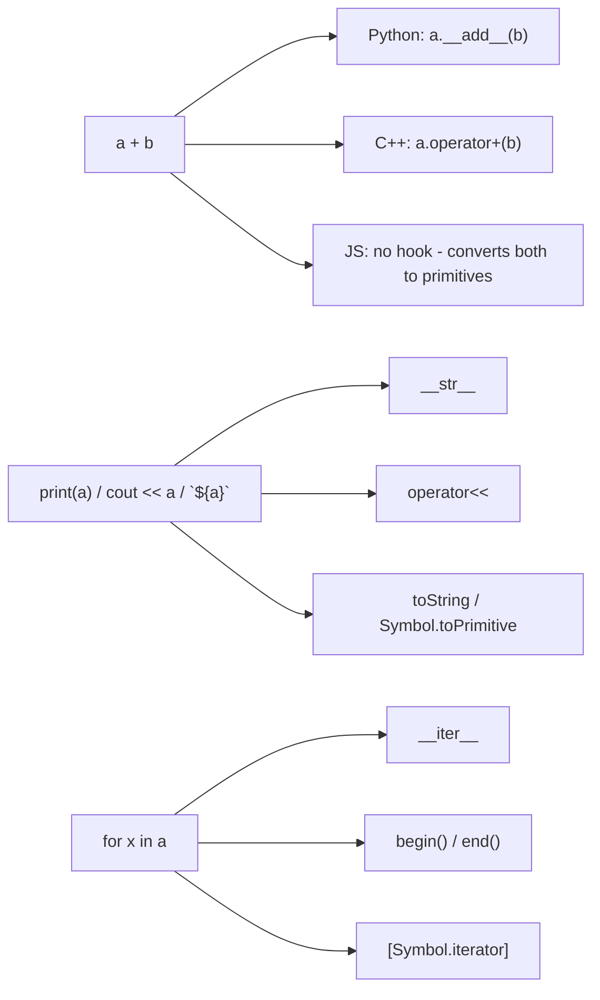

## The idea: hooks the language calls for you

Every language turns its syntax into method calls on your objects. Implement those methods and your class works
with the language's own operators, loops and printing.

## Rules of good overloading
1. **Only when the meaning is obvious.** `money + money` is good; `user + group` is a puzzle.
2. **Keep the usual laws.** `a == b` should mean `b == a`, and `a + b` shouldn't modify `a`.
3. **Equal objects hash equally** (Python `__hash__`, C++ `std::hash` specialisation).
4. **Return new objects** from arithmetic operators. In-place versions (`+=`) are separate (`__iadd__`, `operator+=`).
