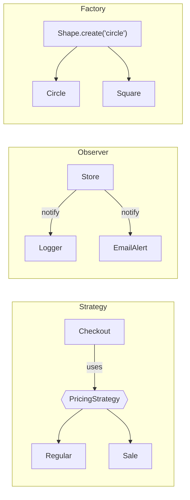

## SOLID in one table

| Letter | Principle | In one sentence | Smell when broken |
|---|---|---|---|
| **S** | Single responsibility | A class should have one reason to change | a `UserManager` doing DB, email and validation |
| **O** | Open/closed | Extend behaviour by adding code, not editing working code | a growing `if type == ...` chain |
| **L** | Liskov substitution | Subclasses must be usable wherever the parent is | a `Square(Rectangle)` whose `set_width` surprises callers |
| **I** | Interface segregation | Many small interfaces beat one fat one | classes implementing methods with `raise NotImplementedError` |
| **D** | Dependency inversion | Depend on abstractions; inject the details | `new MySQLDatabase()` buried inside business logic |

## Patterns you'll actually use

- **Strategy**: swap an algorithm (pricing, sorting, routing) without changing the code that uses it.
- **Observer**: publish events; any number of subscribers react. It's the basis of every UI framework and event bus.
- **Factory**: centralise the "which class do I create?" decision.
- **Adapter**: wrap an awkward API so it fits the interface your code expects.
- **Decorator**: wrap an object to add behaviour while keeping its interface (logging, caching, retries).

> Patterns are vocabulary, not goals. Reach for one when you feel the pain it solves. Every project in the
> **Projects** section is built with these principles; look for them in each step.
